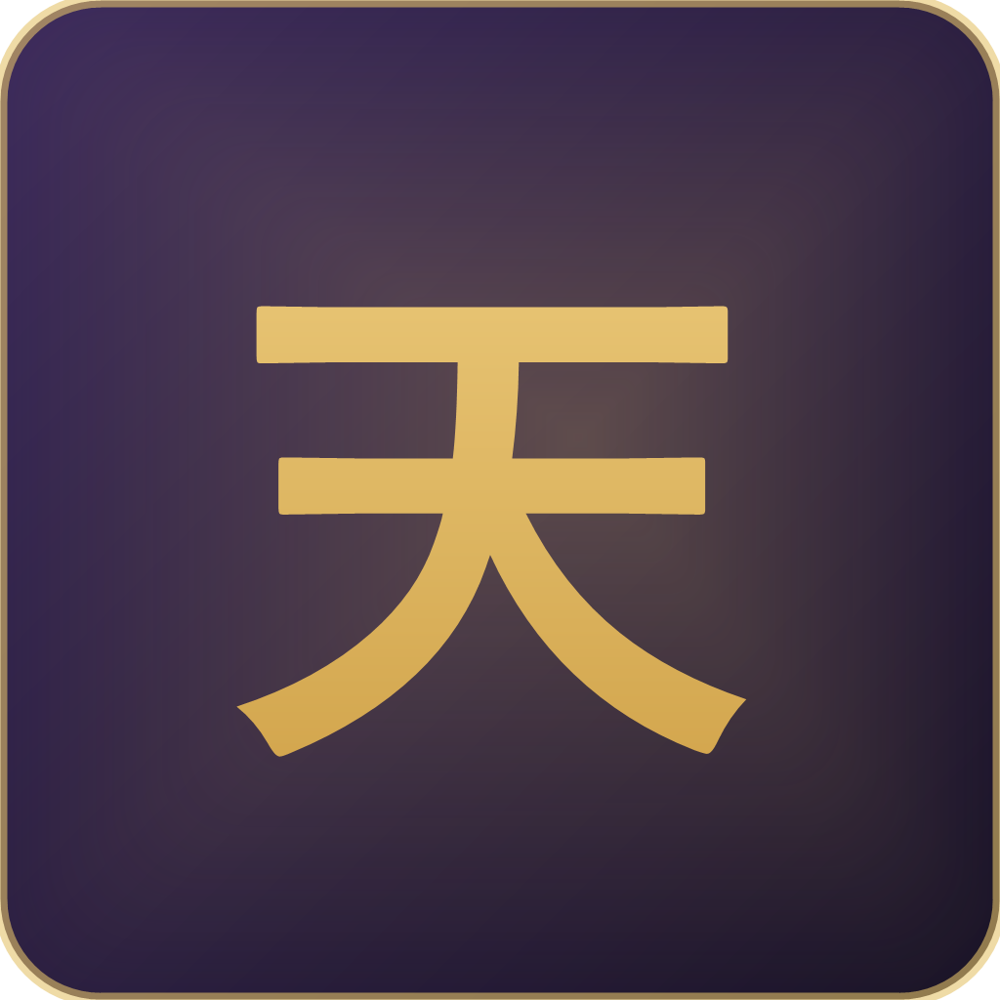
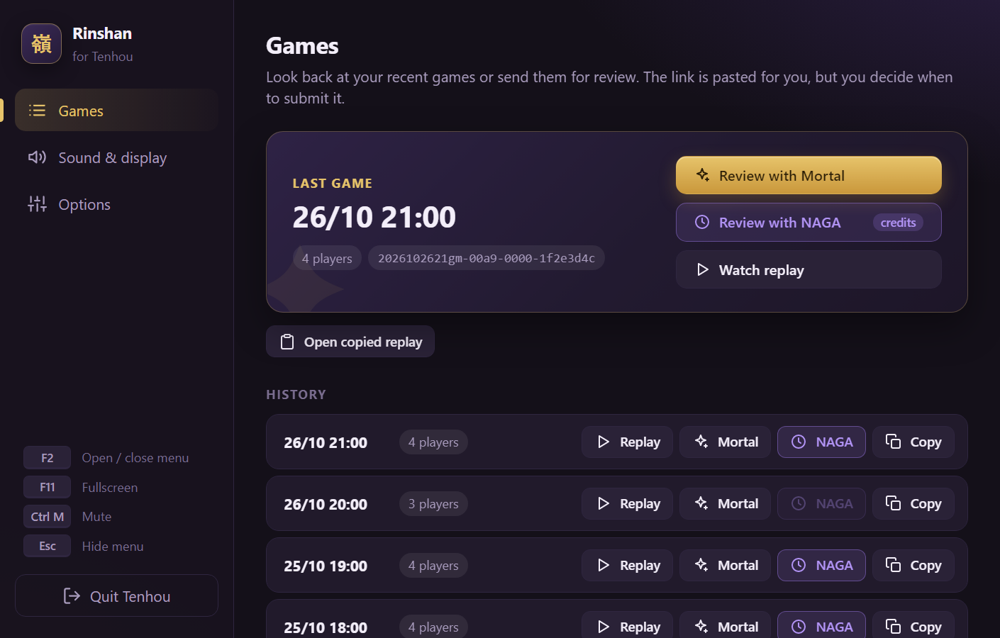

<p align="center">
  
</p>

<h1 align="center">Rinshan</h1>

<p align="center">
  An unofficial desktop app for <a href="https://tenhou.net/3/">Tenhou</a>: play in its own window, no browser needed.
</p>

> [!IMPORTANT]
> **Unofficial project.** Not affiliated with Tenhou / C-EGG, NAGA or Mortal, and not related to Tenhou's own paid Windows and Desktop 4K clients. Rinshan only shows the free Tenhou web client ([tenhou.net/3](https://tenhou.net/3/)) in a window: **it does not automate play or give any kind of in-game assistance.**
>
> *Rinshan* (嶺上) is named after rinshan kaihou, winning on the replacement tile after a kan. Formerly *Tenhou Desktop*.



## Features

- **Its own window**: Tenhou without tabs or an address bar, with its own taskbar icon. Remembers size, position and zoom.
- **F2 menu**: a separate window (you can even move it to another monitor) with:
  - **Your recent games** (the 40 Tenhou keeps): watch the replay, copy the link or send it for review.
  - **Review with Mortal or NAGA**: opens the site with the game link **already pasted and highlighted**, but **never submits it for you**. You check it's the right game and press the button yourself, so a misclick never costs you NAGA credits.
  - Mute, fullscreen, zoom and settings.
- **Who's at your table**: see the players at your current or last table with their rank and rate, and open their [Nodocchi](https://nodocchi.moe/) stats in one click.
- **Private lobbies**: save your friends' lobbies and join them in one click. Optionally show the lobby on Discord with a *Join* button.
- **Screenshots with F12**: saved to `Pictures\Rinshan` and copied, ready to paste.
- **Discord Rich Presence**: friends see what you're doing, like with osu!

  | Moment | Discord shows |
  |---|---|
  | Lobby | In the lobby |
  | Queue | Searching for a game · Houou 鳳凰 · Hanchan · 4p |
  | Game | Playing · Tokujou 特上 · Hanchan · 4p — South 2 · 1 honba · 2nd (28,300) |
  | End | Finished a game — Placed 1st |

- **English, Spanish and Portuguese**: the app comes in all three, and it switches Tenhou's own interface to match.
- **Fills in Tenhou's missing translations**: Tenhou's web client still shows a lot of Japanese (rooms, rules, ranks, yaku, draws, menus). The app translates those on screen into your language. Yaku and mahjong terms stay in romaji in every language (Tanyao, Chiitoitsu, Ryuukyoku…), so everyone uses the same words. It only changes text, never the game itself, and you can turn it off in **F2 → Options**.
- **System tray**: minimizing hides it next to the clock while it keeps running at full speed.
- **Notifications**: if Tenhou plays a sound while you're in another window (e.g. a match starts), the taskbar button flashes.
- **No accidents**: asks before closing so you don't disconnect from a game, and keeps the screen awake while you play.
- **Single instance**: opening the shortcut again brings back the existing window.
- **Updates itself**: when a new version is out, the menu offers to install it in a few seconds. It never updates without asking, and you can turn the check off in **F2 → Options**.
- **Portable**: nothing to install; it's just a folder.

## Download

1. Go to **[Releases](../../releases)** and download the latest `.zip`.
2. Extract it anywhere and run `Rinshan.exe`.

From v1.4.0 on, Rinshan updates itself from the F2 menu. Upgrading from Tenhou Desktop or Rinshan v1.3.0? Download the new zip once and delete the old folder: your settings and Tenhou login are kept.

Requires **Windows 10 or 11**. It uses WebView2, the Microsoft Edge engine that ships with Windows.

## Shortcuts

| Key | Action |
|---|---|
| `F2` | Open / close the menu |
| `F11` | Fullscreen (`Esc` to leave) |
| `F12` | Screenshot |
| `F5` | Reload Tenhou |
| `Ctrl` + `M` | Mute |
| `Ctrl` + wheel / `Ctrl` + `0` | Zoom / reset zoom |

## FAQ

**Is it safe for my account?** The app loads the same page as your browser (`tenhou.net/3/`). Your session is stored only on your PC, in `%LOCALAPPDATA%\Rinshan`.

**How does it know which round I'm in, for Discord?** It listens to the messages Tenhou receives from its server (game start, each round, game end) without modifying them, and only uses information you already see on screen. You can turn it off in **F2 → Options → Show on Discord**.

**How do I change the language?** **F2 → Options → Language**: Automatic (follows Windows), Español, English or Português. Reload Tenhou afterwards (`F5`), ideally outside a game.

**I prefer Tenhou as it is.** In **F2 → Options**, turn off *Translate what Tenhou leaves in Japanese* to see Tenhou's original texts, and *Also change Tenhou's language* to choose Tenhou's language in its own menu.

**Something isn't working.** Use **F2 → Options → Help → Report a problem**, or [open an issue](../../issues/new/choose) directly. Attaching `log.txt` (**F2 → Options → Help → App log**) helps a lot: it only has app events, never your Tenhou ID. What changed in each version is in the [changelog](CHANGELOG.md).

**A translation is wrong or something is still in Japanese.** Please [open an issue](../../issues/new/choose) with a screenshot. The translations live in [`src/translate.js`](src/translate.js) and are easy to extend.

**The window stays black.** Tenhou may be under maintenance or not responding. After 20 seconds the app shows a notice with a retry button.

## Build from source

No Visual Studio needed: it uses the .NET Framework compiler included with Windows.

```powershell
powershell -ExecutionPolicy Bypass -File build.ps1
```

The first run downloads the WebView2 library from NuGet. Output goes to `dist\`, and `tools\package.ps1` zips it into `release\`.

**Releasing:** bump `AssemblyVersion` in `src/Program.cs`, move the changelog's *Unreleased* notes under the new version, then push a matching tag (e.g. `v1.4.0`). GitHub Actions builds the zip and attaches it to a draft release; write the notes and publish it, and the app's updater picks it up.

| Folder | Contents |
|---|---|
| `src/` | C# code (WinForms + WebView2), the menu (`panel.html`) and Tenhou's translations (`translate.js`) |
| `assets/` | Icon and Discord image |
| `tools/` | Scripts to package a release and regenerate the icon and screenshots |
| `.github/` | The release workflow |
| `docs/` | README screenshots |

## License

[MIT](LICENSE). Tenhou (天鳳) is a service by C-EGG; this project does not include any of its artwork.
